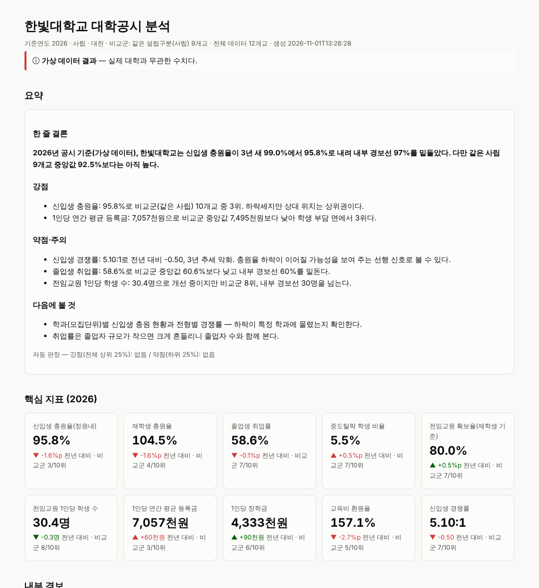

# univ-disclosure — 대학알리미 공시 데이터 분석 스킬

대학알리미(대학정보공시)에서 내려받은 CSV/XLSX로 **한 대학의 핵심 공시 지표를 비교군과 견주어 분석**하고,
**숫자가 검증된 HTML 리포트**를 만드는 Claude Code 스킬입니다.



## 이 스킬이 자동화하는 업무

| 사람이 하던 일 | 스킬에서 |
|---|---|
| 대학알리미에서 항목별 엑셀을 받아 열 이름 맞추기, 머리글 병합 풀기 | `load.py`가 인코딩·다중 머리글·별칭을 처리해 하나의 표로 합침 |
| 비교 대학 골라 평균·순위 내기 | `analyze.py`가 비교군 규칙으로 중앙값·순위·백분위·3년 추세 계산 |
| 보고서 문장 쓰기 | 모델이 `analysis.json`만 근거로 해석 작성 |
| 숫자 틀린 곳 찾기 | `verify.py`가 재계산·범위·근거 없는 숫자·금지 표현을 검사 |
| 차트·표 만들기 | `report.py`가 오프라인에서 열리는 단일 HTML 생성 |

## 하네스 엔지니어링 6가지 구조

| # | 구조 | 역할 | 이 스킬의 파일 |
|---|---|---|---|
| 1 | **지시·컨텍스트** (Instructions & Context) | 무엇을, 어떤 순서·기준으로 할지 모델에게 알려 주는 문서와 도메인 지식 | `SKILL.md`(발동 조건·절차), `references/indicators.csv`·`indicators-guide.md`(지표 정의·해석 주의), `data-sources.md`, `narrative-guide.md` |
| 2 | **도구** (Tools) | 모델이 직접 계산하지 않도록 결정론적 작업을 맡는 실행 도구 | `scripts/load.py`(적재·정규화), `scripts/analyze.py`(지표 계산), `scripts/report.py`(HTML 리포트) |
| 3 | **워크플로우·오케스트레이션** (Orchestration) | 단계 순서, 단계 사이 판단 지점, 사람에게 묻는 지점, 재시도 한도 | `SKILL.md` §2: Step 1→5, 단계별 판단 지점(모호한 열·중복·비교군 부족), 검증 실패 시 Step 3~5 최대 3회 반복 |
| 4 | **가드레일·제약** (Guardrails) | 하면 안 되는 것을 규칙과 코드로 막음 | `references/guardrails.md`, 분교·합계 행 제외와 상식 범위 검사(`load.py`·`analyze.py`), 금지 표현 차단(`verify.py`), "내부 경보선 ≠ 공식 기준"(`thresholds.json`) |
| 5 | **검증·피드백 루프** (Verification & Feedback) | 산출물을 자동 검사하고 실패를 고쳐서 다시 돌림. 오프라인 평가로 스킬 자체도 개선 | `scripts/verify.py`(재계산·범위·근거 없는 숫자·금지어), `tests/test_pipeline.py`, `evals/evals.json`·`trigger_queries.json` |
| 6 | **메모리·상태** (Memory & State) | 실행 사이에 남는 기록과 교훈, 단계 사이의 중간 산출물 | `memory/lessons.md`(배운 함정, 시작 시 읽고 끝에 추가), `memory/run_log.jsonl`(실행 기록 자동 저장), `workspace/`의 `tidy.csv → analysis.json → narrative.md → report.html → verify_report.json` |

```
사용자 요청 ─▶ [1 지시] SKILL.md 발동 · [6 메모리] lessons.md 읽기
             ─▶ [4 가드레일] 대학·파일·비교군 확인 (파일 없으면 멈춤)
             ─▶ [3 워크플로우]
                 Step1 load.py ──▶ tidy.csv          ┐
                 Step2 analyze.py ─▶ analysis.json    │ [2 도구]
                 Step3 모델 해석 ─▶ narrative.md       │
                 Step4 report.py ──▶ report.html      ┘
                 Step5 verify.py ──▶ 통과? ── 아니오 ─▶ Step3로 (최대 3회) [5 검증]
                                     └ 예 ─▶ 결과 전달 · lessons.md 갱신 [6 메모리]
```

## 설치와 사용

```bash
# 개인 스킬로 설치
cp -r .claude/skills/univ-disclosure ~/.claude/skills/
pip install pandas openpyxl        # 테스트용: pytest
```

Claude Code에서:

```
/univ-disclosure 한빛대학교 — 파일은 ./downloads 폴더
대학알리미 엑셀로 우리 학교 충원율·취업률을 비슷한 사립대랑 비교해줘
```

스크립트만 직접 돌릴 수도 있습니다.

```bash
SK=~/.claude/skills/univ-disclosure
python3 $SK/scripts/load.py ./downloads --out workspace
python3 $SK/scripts/analyze.py --tidy workspace/tidy.csv --school "○○대학교" --peer-rule same_founding
python3 $SK/scripts/report.py --analysis workspace/analysis.json --narrative workspace/narrative.md
python3 $SK/scripts/verify.py --dir workspace
```

## 연습용 데이터

`sample_data/`는 **가상 데이터**입니다(학교명·수치 모두 지어냄). 대학알리미 파일 형태(2줄 머리글, cp949 CSV, 연도 없는 XLSX, 분교·합계·중복 행)를 흉내 내 로더를 시험합니다.
`python3 sample_data/make_sample.py`로 다시 만들 수 있고, 결과 예시는 `examples/hanbit_sample/report.html`입니다.

## 테스트

```bash
python3 -m pytest tests -q     # 5 passed
```

## 한계
- 대학알리미 메뉴·파일 양식은 바뀔 수 있습니다. 새 열 이름은 `references/indicators.csv`의 `aliases`에 더합니다.
- `thresholds.json`의 경보선은 참고용 내부 값이며 정부 평가의 공식 기준이 아닙니다.
- 공시 수치는 학교의 정정 공시로 바뀔 수 있으니 중요한 결정 전에는 원문을 확인하세요.
